# SupplyPilot

**採購作業管理 × 有來源的 AI 查詢**

SupplyPilot 是採購與供應鏈管理平台，將供應商、物料、採購單、庫存和企業文件集中在一個工作環境。採購人員可追蹤採購單從草稿、審核、下單、驗收到付款確認的進度，並使用 AI 查詢業務資料或檢索已核准的文件。

## 專案要處理的問題

採購人員需要在試算表、供應商文件、庫存資料與人工追蹤紀錄之間切換。採購單進度、不同交期、實際到貨和文件依據容易分散，增加追蹤與交接成本。

SupplyPilot 把採購流程和相關資料放在同一個系統中。系統以後端狀態、權限與資料庫交易管理採購異動；AI 用於協助查詢，並提供可回頭核對的來源。

## 主要功能

- **採購單與八階段看板：** 新採購可直接建立 PO 草稿，依序經過尋源、審核、下單追蹤、到貨驗收、請款核銷與完成。看板階段和正式採購單狀態分開保存，操作由後端業務命令執行。
- **收貨、庫存與付款狀態：** 到貨數量和品質確認完成後才整筆收貨入庫，並留下庫存交易紀錄。付款由人員手動確認；系統不執行金流。
- **交期管理：** 分開保存公司期望到貨日與供應商最新承諾日，避免以供應商更新覆蓋原本的採購需求。
- **主檔與庫存：** 管理物料、供應商、供應關係、庫存調整、盤點匯入與歷史交易。
- **採購資料 AI 查詢：** 以自然語言查詢供應商、報價、庫存和採購單等資料。查詢工具採唯讀設計；AI 輔助建立的採購草稿仍須由使用者確認。
- **文件 RAG 問答：** 使用 Spring AI 與 PostgreSQL/pgvector 檢索文件片段，回傳文件來源和摘錄。文件須符合審核及外送政策；回答附來源不等於答案已被獨立證明正確。

## 架構

React 前端經 Nginx 呼叫 Spring Boot REST API。後端負責登入驗證、權限、採購規則與交易；MySQL 保存採購及庫存資料；PostgreSQL/pgvector 保存文件向量索引，原始文件則存放於獨立持久化儲存。

[架構與服務說明](docs/architecture/README.md) · [專案簡報](docs/presentations/supplypilot-project-overview.html)

## 技術選型

| 層次 | 技術 |
| --- | --- |
| 前端 | React、TypeScript、Vite、Ant Design |
| 後端 | Java 21、Spring Boot、Spring Security、Spring Data JPA |
| 業務資料庫 | MySQL、Flyway |
| 文件語意檢索 | PostgreSQL、pgvector、Spring AI、Gemini Provider（選配） |
| 本機服務 | Docker Compose、Nginx |

## 工程設計重點

- **採購狀態與交易一致性：** PO 狀態轉換由後端驗證；收貨在同一交易中更新採購單、庫存和 StockTransaction。使用列鎖、版本欄位及資料庫約束處理競態與不合法狀態。
- **權限與歷史紀錄：** 使用 JWT 與後端權限檢查；保存重要操作的操作者快照，讓歷史資料不依賴帳號目前的名稱。
- **文件索引生命週期：** 審核、索引和查詢分開管理；索引工作可持久化、重試並檢查文件版本及出站資格。
- **AI 權限邊界：** AI 查詢不直接核准、下單、收貨或確認付款；文件外送需先符合政策。
- **資料庫演進：** 以 Flyway 管理 schema 版本，透過明確 migration 演進既有資料。

## 目前進度與驗證狀態

以下依本機 main 程式與截至 2026-11-02 的最新進度文件整理；「已實作」不代表整體 Release Gate 已完成。

- **採購流程：** 本機 main 已包含 V2 PO 草稿、八階段 Stage、看板／列表、驗收與人工付款確認等程式。階段與交易驗收證據分散在 [V2 Issue 驗證紀錄](docs/evidence/)；仍須以各紀錄標示的測試範圍判讀。
- **文件 RAG：** Spring AI Advisor、PgVectorStore 與持久化索引工作已整合。Compose 預設不啟用 Chat／Embedding Provider，語意讀取也預設關閉。11/02 本機 Demo 有一項 Chrome AI 文件查詢回傳 ANSWERED 與 10 筆來源；這只驗證單一查詢流程，不代表整體答案品質通過。詳見[瀏覽器驗證紀錄](docs/evidence/ai-query-supplier-scope-refactor-2026-11-01.md)與[RAG 程式驗證紀錄](docs/evidence/local-main-rag-postprocessor-removal-2026-11-01.md)。
- **Gemini 查詢實測：** 2026-11-02 本機 Demo 的 10 題配對實驗中，Tool Calling 有 1 題完整正確、5 題部分回答、1 題錯誤及 3 題 API 失敗；實驗中的 Agentic SQL 沒有完整可用答案，並有 4 題 API 失敗。這是每題單次呼叫的探索性結果，不代表所有題型；Agentic SQL 為預設關閉的實驗路徑。詳見[完整紀錄](docs/experiments/agentic-sql/evidence/ab-2026-11-02-live-gemini-demo/README.md)。
- **整體驗收：** 最新保存的全量 Backend Maven verify 紀錄為 2026-11-01 的 FAIL，1,093 個測試中有 4 個失敗；其中 3 個在基底版本也能重現。後續有程式修改，但全量 verify 尚未在最新 main 重跑。AWS 上線與完整端到端驗收也未宣稱完成。詳見[驗證紀錄](docs/evidence/spring-ai-rag-validation-2026-11-01.md)。

## 延伸閱讀

- [V2 需求與模組說明](docs/v2/README.md)
- [採購與 Kanban 規格及實作紀錄](docs/v2/procurement-and-kanban.md)
- [Documents / RAG 設計與限制](docs/v2/document-rag.md)
- [本機開發與部署說明](docs/local-development-and-deployment.md)：承接原 README，包含操作步驟與歷史狀態快照，執行前請核對適用版本。
